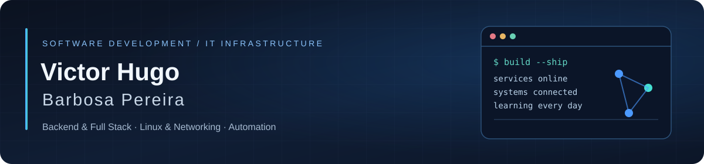

  

  
  
  
  

## About

I'm a developer based in Brazil, focused on **software development, backend systems and IT infrastructure**. I started programming and working with servers in 2024, and provided paid independent services in server setup, hosting and technical support in 2025.

I enjoy working across the application and infrastructure layers: building web apps and Discord integrations, administering Linux servers, configuring network services and troubleshooting production-like environments.

Currently studying **Systems Development** at Grau Técnico and completing a **Computer & Network Installation and Repair apprenticeship** at SENAI.

**Career focus:** backend / full stack development, infrastructure, Linux, networking and technical support. **Remote preferred**, open to hybrid and on-site opportunities.

<b>Sobre mim — português</b>

 
Sou desenvolvedor em formação nas áreas de software e infraestrutura de TI. Tenho experiência prática com servidores Linux e Windows, hospedagem, redes, bancos de dados e bots para Discord. Atuei com serviços autônomos remunerados em 2025 e desenvolvo projetos próprios, incluindo uma plataforma SaaS. Busco vagas de estágio ou júnior, com preferência pelo trabalho remoto e abertura para oportunidades híbridas e presenciais.

## Featured work

| Project | What it involves | Status |
| :--- | :--- | :--- |
| **MELUVIO** | Independently developing a multi-tenant SaaS foundation with web dashboard, API, Discord bot, authentication and tickets. **JavaScript, Node.js, React, Next.js, Fastify, PostgreSQL and Prisma**. | In development · private source |
| **[Mekanism Version Locked](https://github.com/victor0hxz/Mekanism-Version-Locked)** | Community compatibility and maintenance work for Mekanism on modern Minecraft / NeoForge. | Public |
| **[Applied Mekanistics Version Locked](https://github.com/victor0hxz/Applied-Mekanistics-Version-Locked)** | AE2 / Mekanism integration compatibility, with original project attribution and licenses preserved. | Public |
| **[JEMM Version Locked](https://github.com/victor0hxz/JEMM-Version-Locked)** | Community adaptation of Just Enough Mekanism Multiblocks for the current modded Minecraft environment. | Public |
| **REDE INIFINTY** | Co-created a Minecraft server network; handled hosting, a Discord bot and technical onboarding for the other owners. | Previous project · inactive |

The MELUVIO platform is still being developed, not presented as a publicly launched commercial product. Community mod ports are credited to their original authors in their respective repositories.

## Tech stack

**Languages & web**

**Application development**

**Databases & infrastructure**

Also worked with Windows Server, Apache and VirtualBox. Currently learning Python and Lua; building further experience with database administration, networks and cloud platforms.

## Practical experience

- **Independent IT services (2025):** configured Linux servers, VPS and game hosting, managed panels and databases, and supported clients with troubleshooting and setup.
- **Networking & hosting:** worked with DNS, TCP/IP, firewalls, SSH, virtualization, server administration and game-server infrastructure.
- **SENAI structured cabling project (2026):** participated in a team exercise to plan and implement a structured cabling environment for a simulated business.

## GitHub activity

The public-repository list below is maintained by a [GitHub Actions workflow](./.github/workflows/update-repositories.yml) that checks for updates hourly. The selected projects above are curated; this list changes automatically.

<b>See recently updated public repositories</b>

<!-- REPOSITORIES:START -->
| Repository | Description | Language |
| --- | --- | --- |
| [Mekanism-Version-Locked](https://github.com/victor0hxz/Mekanism-Version-Locked) | Mekanism Version Locked — community compatibility build for Minecraft 26.1.2 / NeoForge | Java |
| [JEMM-Version-Locked](https://github.com/victor0hxz/JEMM-Version-Locked) | Just Enough Mekanism Multiblocks Version Locked — community compatibility build for Minecraft 26.1.2 / NeoForge | Java |
| [MekanismMoreMachine-Version-Locked](https://github.com/victor0hxz/MekanismMoreMachine-Version-Locked) | Community Version Locked compatibility port of Mekanism MoreMachine for Minecraft 26.1.2 and ATM11 0.9.0; original MIT credits preserved. | Java |
| [MekanismExtras-Version-Locked](https://github.com/victor0hxz/MekanismExtras-Version-Locked) | Mekanism Extras Version Locked — community compatibility build for Minecraft 26.1.2 / NeoForge | Java |
| [MekanismGenerators-Version-Locked](https://github.com/victor0hxz/MekanismGenerators-Version-Locked) | MekanismGenerators Version Locked — community compatibility build for Minecraft 26.1.2 / NeoForge | Java |
| [Applied-Mekanistics-Version-Locked](https://github.com/victor0hxz/Applied-Mekanistics-Version-Locked) | Community port for Minecraft 26.1.2: AE2 and Mekanism Version Locked chemical integration with Extras support. Original credits and licenses preserved. | Java |
| [RFToolsBuilder-Version-Locked](https://github.com/victor0hxz/RFToolsBuilder-Version-Locked) | RFToolsBuilder Version Locked — community compatibility build for Minecraft 26.1.2 / NeoForge | Java |
| [ExtraHNN-Version-Locked](https://github.com/victor0hxz/ExtraHNN-Version-Locked) | Extra Hostile Neural Networks Version Locked — community compatibility build for Minecraft 26.1.2 / NeoForge | Java |
| [MultiBuilderTool-Version-Locked](https://github.com/victor0hxz/MultiBuilderTool-Version-Locked) | Multi Builder Tool Version Locked — community compatibility build for Minecraft 26.1.2 / NeoForge | Java |
| [SFM-Version-Locked](https://github.com/victor0hxz/SFM-Version-Locked) | Super Factory Manager Version Locked — community compatibility build for Minecraft 26.1.2 / NeoForge | Java |
| [TorchMaster-Version-Locked](https://github.com/victor0hxz/TorchMaster-Version-Locked) | TorchMaster Version Locked — community compatibility build for Minecraft 26.1.2 / NeoForge | Java |
| [RFToolsUtility-Version-Locked](https://github.com/victor0hxz/RFToolsUtility-Version-Locked) | RFToolsUtility Version Locked — community compatibility build for Minecraft 26.1.2 / NeoForge | Java |
<!-- REPOSITORIES:END -->

  

---

  Focused on building, learning, documenting and keeping systems reliable.

